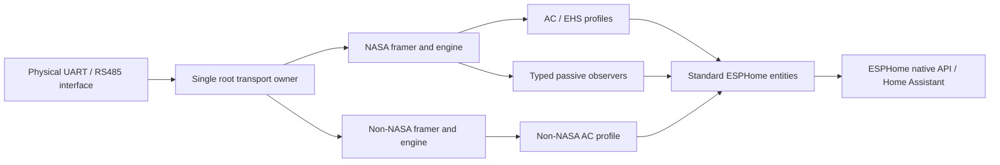

# Developer architecture

One public external component uses flat private C++ sources because the tested ESPHome loader does not recursively package arbitrary nested source directories. Logical modules remain separate; the flat layout is not a monolithic protocol state machine.

Exactly one protocol branch is constructed per root. Separate physical UART roots may choose different engines. Products/observers receive borrowed synchronous decoded packets and cannot open a UART or own a scheduler. Do not reenter engine receive callbacks or retain borrowed packet storage. Per-profile state and the typed descriptor copy have explicit lifetimes; root arrays bound 8 profiles/32 observers.

Transport owns the only RX path and serialized, bounded internal TX scheduler. Production never enables TX. NASA/Non-NASA codecs and lifecycle state machines remain independent; Non-NASA host tests link no NASA implementation. Product adapters translate pure state into SDK entities. Do not infer action/availability/restore or publish an optimistic command as current state.

The NASA read lifecycle, Non-NASA registration/control lifecycle and advanced Guard are host-tested infrastructure with no production submission bridge. The Guard is immutable/noncopyable and has no encoder/UART. A future active integration needs actual scheduler completion/cancellation, one policy owner per target, capture-backed family/range/sentinel rules and authorized physical tests. An arbitrary verified_family assertion or custom descriptor is not evidence.

To extend a read mapping, first inspect license/evidence, add a descriptor with all type/unit/scale/signedness/sentinel/source fields, keep ambiguities disabled, add synthetic/captured provenance honestly, test codec/profile isolation and actual YAML/codegen/firmware. Do not transplant a tightly coupled legacy implementation. Review [ADRs](../architecture/adr/0001-public-component-packaging.md), [catalog](../protocol/message-catalog.md), [testing](testing.md), [write policy](write-policy.md) and [licensing](dependencies.md).
